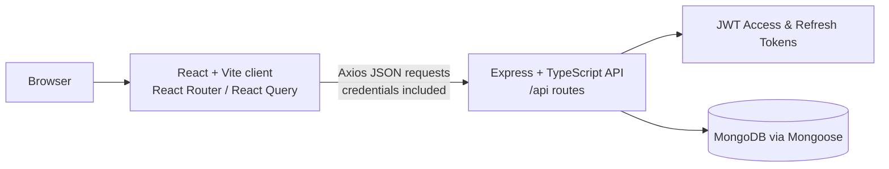
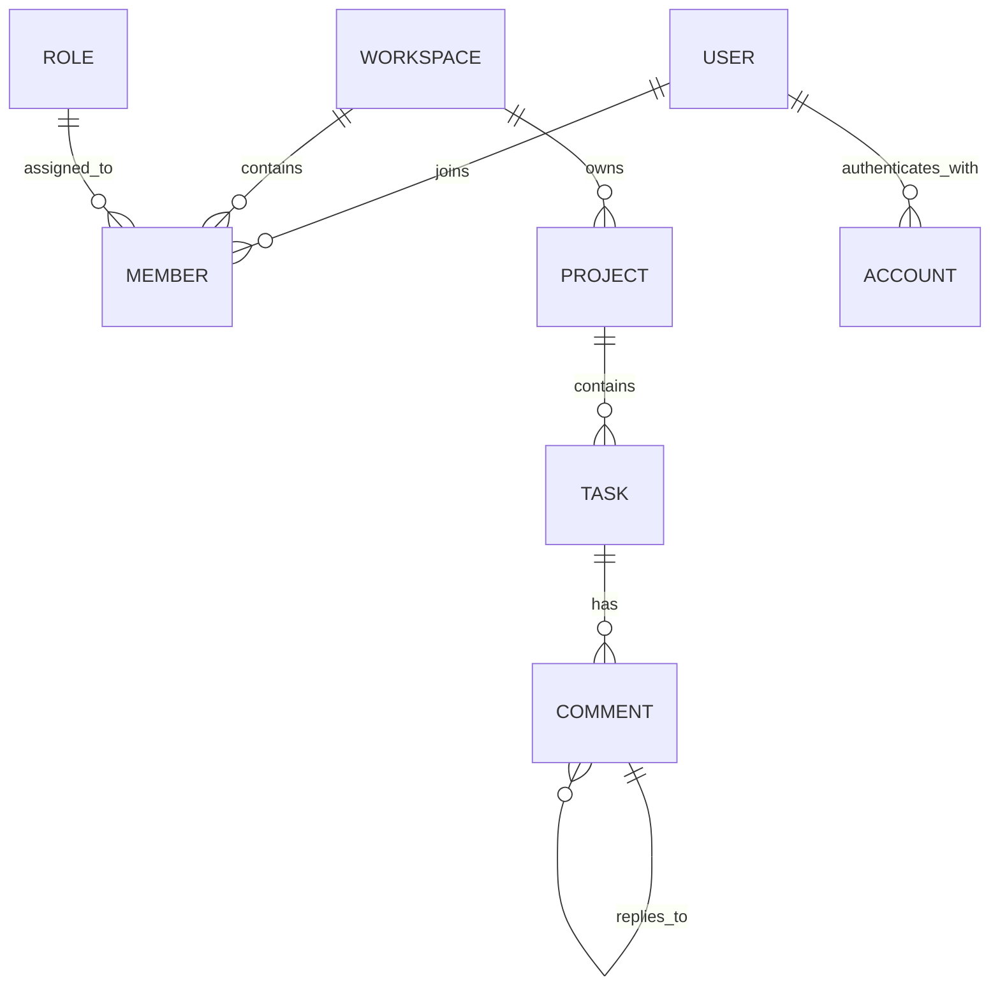
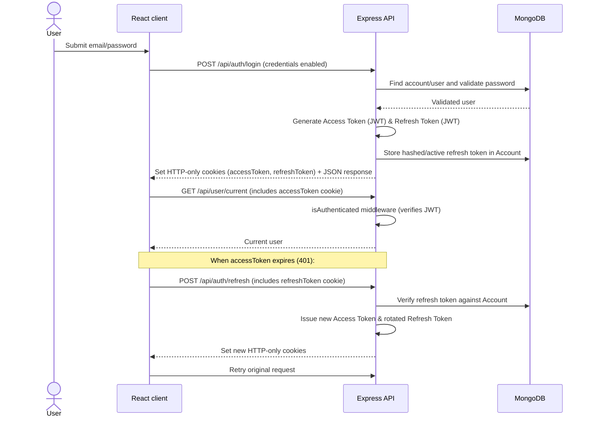

# Project Architecture

This document describes the repository as implemented: a React single-page application backed by an Express/TypeScript API and MongoDB. It focuses on the major layers, request/data flows, domain relationships, and where to find each part of the code.

## 1. System overview



The client and backend are separate applications with their own package manifests. The client is served by Vite during development and calls the backend using `VITE_API_BASE_URL`. The API defaults to port `5000` and route prefix `/api`; it enables credentialed CORS for the configured frontend origin. Authentication uses JWT with short-lived Access Tokens (15 min) and rotating Refresh Tokens (7 days) via HTTP-only cookies and Bearer tokens. MongoDB stores users, accounts, workspaces, memberships/roles, projects, and tasks.

## 2. Repository layout

```text
.
├── backend/
│   ├── src/
│   │   ├── @types/             Express/session TypeScript extensions
│   │   ├── common/             Middleware, enums, and shared utilities
│   │   ├── config/             App, HTTP, MongoDB, Passport, Redis config
│   │   ├── modules/            Feature modules (auth, user, workspace, ...)
│   │   ├── seeders/            Role/permission seed script
│   │   └── index.ts            Express composition and server startup
│   ├── package.json
│   └── tsconfig.json
└── client/
    ├── src/
    │   ├── components/         Shared UI and feature components
    │   ├── constant/           Client-side permission/constants
    │   ├── context/             Query and authenticated workspace context
    │   ├── hooks/               UI hooks and API/query hooks
    │   ├── layout/              Base and authenticated app layouts
    │   ├── lib/                 Axios client, API functions, helpers
    │   ├── page/                Route-level screens
    │   ├── routes/              Route definitions and guards
    │   ├── types/               API and error types
    │   ├── App.tsx              Route tree entry
    │   └── main.tsx             React bootstrap/providers
    ├── package.json
    └── vite.config.ts
```

## 3. Backend architecture

### Startup and middleware

`backend/src/index.ts` is the composition root. It loads environment variables, configures JSON and URL-encoded parsing, adds cookie-parser, enables CORS, registers the health endpoint, mounts feature routers, installs the centralized error handler, starts the HTTP listener, and connects to MongoDB.

The default API prefix is `/api`. Routes under `/api/auth` are public for registration, login, token refresh, and logout. The `/api/user`, `/api/workspace`, `/api/member`, `/api/project`, and `/api/task` routers are mounted behind `isAuthenticated`.

### Feature module pattern

Most backend features live under `backend/src/modules/<feature>/`. A module typically contains:

| File | Responsibility |
| --- | --- |
| `<feature>.routes.ts` | Maps HTTP methods/paths to controllers |
| `<feature>.controller.ts` | Reads request inputs and writes HTTP responses |
| `<feature>.service.ts` | Implements feature operations and coordinates data access |
| `<feature>.model.ts` | Defines the Mongoose schema/model |
| `<feature>.validation.ts` | Defines request validation where present |
| `index.ts` | Exports the module router |

The current modules are `auth`, `user`, `workspace`, `member`, `project`, `task`, `teams`, `association`, `chats`, and `notification`. The controller/service split keeps HTTP concerns separate from application logic; Mongoose models own persistence schemas.

### Shared backend concerns

- `common/middlewares/asyncHandler.middleware.ts` forwards rejected async handlers to Express error processing.
- `common/middlewares/errorHandler.middleware.ts` normalizes API errors.
- `common/middlewares/isAuthenticated.middleware.ts` verifies JWT access tokens (from cookies or Bearer Authorization headers) and attaches the authenticated user.
- `common/enums/` defines role names, permissions, and API error codes.
- `common/utils/` contains password hashing, JWT generation/verification, role/permission lookup and guards, environment access, UUID helpers, and application errors.
- `config/app.config.ts` reads server settings and JWT configuration; `database.config.ts` opens the Mongoose connection.
- `config/redis.config.ts` exists as a Redis configuration module. The current server entry point does not wire it into request processing.
- `seeders/role.seeder.ts` initializes role documents and their permission arrays.

### Authentication and authorization

Authentication uses JSON Web Tokens (JWT) with dual tokens:
1. **Access Token**: Short-lived token (15 minutes) signed with `JWT_ACCESS_SECRET` containing `{ userId }`. Transmitted via HTTP-only cookie or Bearer authorization header.
2. **Refresh Token**: Long-lived token (7 days) signed with `JWT_REFRESH_SECRET` and persisted in MongoDB `Account` collection. Transmitted via HTTP-only cookie and rotated on refresh.

On successful login, the server sets HTTP-only `accessToken` and `refreshToken` cookies and returns token payloads. On token expiration, the client interceptor automatically hits `/api/auth/refresh` to rotate tokens silently without interrupting user activity.

Authentication is enforced at the protected API router boundary. Workspace roles and permissions are represented by role and membership data; backend helper utilities support role checks. The client also loads the current user and selected workspace, derives permissions, and uses route/component guards to shape the UI. Server-side checks remain the security boundary.

### API surface

All paths below are relative to `BASE_PATH` (default `/api`):

| Router | Example operations |
| --- | --- |
| `/auth` | `POST /register`, `POST /login`, `POST /refresh`, `POST /logout` |
| `/user` | `GET /current` |
| `/workspace` | Create/update/delete workspaces, list user workspaces, fetch workspace details, members, analytics, change member role |
| `/member` | Join workspace using an invite code |
| `/project` | Create/list/get/update/delete projects scoped to a workspace; project analytics |
| `/task` | Create/list/get/update/delete tasks scoped to a project/workspace |
| `/comments` | Paginated task comments, replies, reactions, mentions, edits & soft-deletes |
| `/notifications` | List user notifications (paginated), unread count, mark read, mark all read, delete, clear, queue notifications |

For exact request schemas and response behavior, use each feature's route, controller, validation, and service files as the source of truth.

## 4. Frontend architecture

### Bootstrap and providers

`client/src/main.tsx` mounts the React application in `StrictMode`, wraps it with the TanStack Query provider and Nuqs adapter, and renders the shared toast host. `App.tsx` delegates to the route tree.

### Routing and page composition

`routes/index.tsx` creates the browser router. It groups public/base routes, authentication routes, and protected application routes. `AuthRoute` and `ProtectedRoute` control access. Protected pages render within `AppLayout`; public/auth pages use `BaseLayout`.

Route definitions are centralized in `routes/common/routes.tsx`, with path constants in `routes/common/routePaths.ts`. Screens under `page/` cover sign-in/sign-up, invite acceptance, workspace dashboard, tasks, members, settings, project details, and error pages.

### UI, state, and API access

- `components/ui/` contains reusable primitives (Radix-based components styled for the application).
- `components/workspace/` contains workspace, member, project, and task feature UI.
- `hooks/api/` contains API-facing hooks, generally using TanStack Query for server state and cache/refetch behavior.
- `context/query-provider.tsx` configures the query client.
- `context/auth-provider.tsx` combines current-user and selected-workspace queries, exposes identity/workspace/permission helpers, and redirects on workspace access failure.
- `hooks/` contains local UI behavior such as workspace ID selection, permissions, filters, and dialogs.
- `lib/axios-client.ts` creates the credentialed Axios instance using `VITE_API_BASE_URL`; `lib/api.ts` groups API calls; `lib/helper.ts` and `lib/utils.ts` provide shared helpers.
- `types/api.type.ts` and `types/custom-error.type.ts` describe client-side API data and errors.

The application uses React Query for remote/server state and React context/hooks for cross-page authentication and workspace state. URL query-state support is provided through Nuqs; task tables use TanStack Table.

## 5. Domain model

The core product hierarchy is:



- **User** represents a person in the application.
- **Account** represents an authentication provider/account association for a user.
- **Workspace** is the collaboration boundary and has members and projects.
- **Member** links a user to a workspace and carries the member's role.
- **Role** stores a role name and allowed permissions; `role-permission.model.ts` defines its schema and the role seeder populates it.
- **Project** belongs to a workspace and groups work.
- **Task** belongs to a project/workspace and tracks assigned work and task state (see `task.enum.ts`).

The exact stored fields and reference strategies are defined in the corresponding Mongoose models.

## 6. Typical request flows

### Sign-in and authenticated API call



### Workspace task data

1. The client obtains the workspace identifier from the route/context and loads workspace, projects, members, or tasks through API hooks.
2. Axios sends requests to the configured API URL with session credentials.
3. Express authenticates the session, routes the request to the feature controller, and the service performs workspace-scoped operations through Mongoose.
4. The response updates React Query's server-state cache; pages and components render the returned data and permission-dependent actions.

## 7. Configuration and local commands

Configuration is read from environment variables in the backend. The relevant names include `NODE_ENV`, `PORT`, `BASE_PATH`, `MONGO_URI`, `SESSION_SECRET`, `SESSION_EXPIRES_IN`, and `FRONTEND_ORIGIN`. The client expects `VITE_API_BASE_URL`. Keep actual secrets and environment-specific values in local environment files; this architecture document intentionally contains no secret values.

| Working directory | Command | Purpose |
| --- | --- | --- |
| `backend/` | `npm run dev` | Run the TypeScript API in development |
| `backend/` | `npm run build` | Compile TypeScript to `dist/` |
| `backend/` | `npm start` | Run the compiled API |
| `backend/` | `npm run seed` | Seed role and permission records |
| `client/` | `npm run dev` | Start Vite development server |
| `client/` | `npm run build` | Type-check and build the client |
| `client/` | `npm run lint` | Run ESLint |

## 8. Architectural boundaries at a glance

```text
Page / component
  -> feature hook (React Query)
    -> API function (lib/api.ts)
      -> Axios client (cookie credentials)
        -> Express router + authentication middleware
          -> controller (HTTP boundary)
            -> service (use-case logic)
              -> Mongoose model (MongoDB persistence)
```

This map is a guide to code ownership: UI behavior belongs in pages/components/hooks, HTTP transport in the client API layer and backend controllers/routes, business operations in backend services, and persistence shape in Mongoose models.
