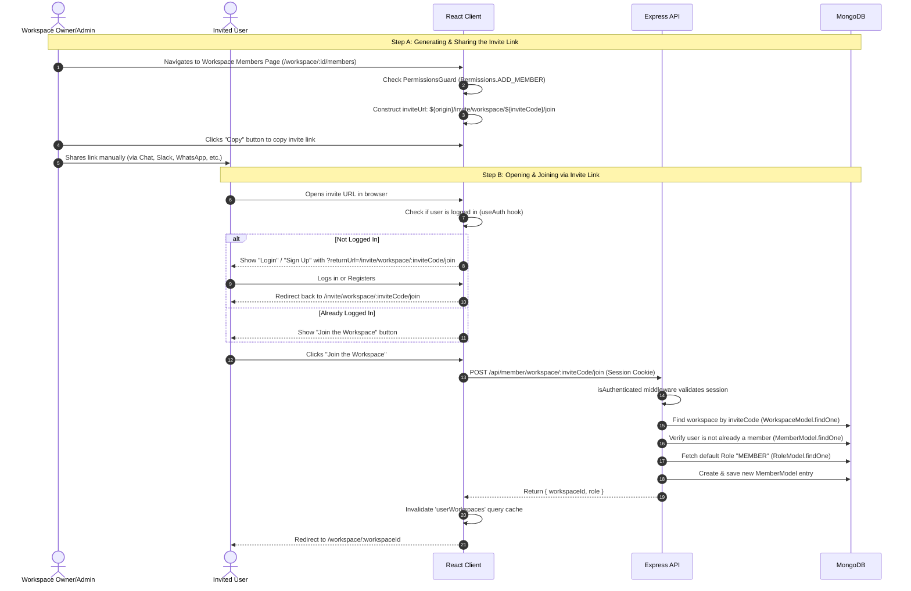
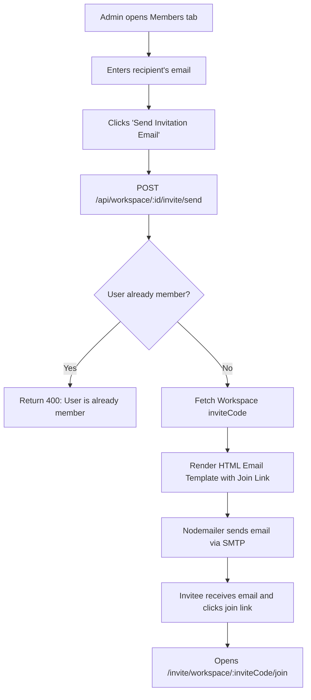

# Workspace Invite Flow Architecture & Implementation Guide

This document explains in detail how the workspace invitation system works in this project (both the **currently implemented link-based invite flow** and the **direct email invite flow** using `nodemailer`).

---

## 1. Overview of Invite Flows

The application supports two complementary approaches for inviting members to a workspace:

```
┌─────────────────────────────────────────────────────────────────────────────┐
│                             WORKSPACE INVITATION                            │
├──────────────────────────────────────┬──────────────────────────────────────┤
│ 1. Current Link-Based Flow (Active) │ 2. Email-Based Flow (With Nodemailer)│
│    - Workspace generates unique code │    - Admin enters invitee email      │
│    - Admin copies public invite URL  │    - System sends styled HTML email  │
│    - Invitee visits URL and joins    │    - Invitee clicks link in inbox    │
└──────────────────────────────────────┴──────────────────────────────────────┘
```

---

## 2. Currently Implemented Link-Based Flow

### Architecture & Sequence Diagram



---

## 3. Deep Dive into Key Components (Current Flow)

### 3.1 Data Model: Invite Code Generation & Storage
- **File**: [`workspace.model.ts`](file:///c:/Users/ranaj/Downloads/Advanced-MERN-B2B-Teams-Project-Management-Saas-main/Advanced-MERN-B2B-Teams-Project-Management-Saas-main/backend/src/modules/workspace/workspace.model.ts)
- **Generator**: [`uuid.ts`](file:///c:/Users/ranaj/Downloads/Advanced-MERN-B2B-Teams-Project-Management-Saas-main/Advanced-MERN-B2B-Teams-Project-Management-Saas-main/backend/src/common/utils/uuid.ts)
- Every workspace automatically gets an 8-character unique alphanumeric invite code when created:
  ```typescript
  export function generateInviteCode() {
    return uuidv4().replace(/-/g, "").substring(0, 8);
  }
  ```
- The `workspaceSchema` includes a helper method to rotate/invalidate old invite codes:
  ```typescript
  workspaceSchema.methods.resetInviteCode = function () {
    this.inviteCode = generateInviteCode();
  };
  ```

### 3.2 Frontend Copy Link Component
- **File**: [`invite-member.tsx`](file:///c:/Users/ranaj/Downloads/Advanced-MERN-B2B-Teams-Project-Management-Saas-main/Advanced-MERN-B2B-Teams-Project-Management-Saas-main/client/src/components/workspace/member/invite-member.tsx)
- Renders only if the current user has `Permissions.ADD_MEMBER`.
- Reads `workspace.inviteCode` from `useAuthContext()`.
- Generates the URL:
  ```typescript
  const inviteUrl = `${window.location.origin}/invite/workspace/${workspace.inviteCode}/join`;
  ```
- Allows one-click copying to clipboard with toast notification.

### 3.3 Frontend Join Page
- **File**: [`InviteUser.tsx`](file:///c:/Users/ranaj/Downloads/Advanced-MERN-B2B-Teams-Project-Management-Saas-main/Advanced-MERN-B2B-Teams-Project-Management-Saas-main/client/src/page/invite/InviteUser.tsx)
- Mounted at base route: `BASE_ROUTE.INVITE_URL = "/invite/workspace/:inviteCode/join"` (defined in [`routePaths.ts`](file:///c:/Users/ranaj/Downloads/Advanced-MERN-B2B-Teams-Project-Management-Saas-main/Advanced-MERN-B2B-Teams-Project-Management-Saas-main/client/src/routes/common/routePaths.ts)).
- If unauthenticated, provides Sign In / Sign Up buttons with the `returnUrl` query parameter so the user seamlessly returns after authentication.
- If authenticated, triggers `invitedUserJoinWorkspaceMutationFn(inviteCode)`.

### 3.4 Backend Join Service & Route
- **Route**: [`member.routes.ts`](file:///c:/Users/ranaj/Downloads/Advanced-MERN-B2B-Teams-Project-Management-Saas-main/Advanced-MERN-B2B-Teams-Project-Management-Saas-main/backend/src/modules/member/member.routes.ts)
  ```typescript
  memberRoutes.post("/workspace/:inviteCode/join", joinWorkspaceController);
  ```
- **Service**: [`member.service.ts`](file:///c:/Users/ranaj/Downloads/Advanced-MERN-B2B-Teams-Project-Management-Saas-main/Advanced-MERN-B2B-Teams-Project-Management-Saas-main/backend/src/modules/member/member.service.ts)
  ```typescript
  export const joinWorkspaceByInviteService = async (
    userId: string,
    inviteCode: string
  ) => {
    // 1. Verify workspace exists
    const workspace = await WorkspaceModel.findOne({ inviteCode }).exec();
    if (!workspace) {
      throw new NotFoundException("Invalid invite code or workspace not found");
    }

    // 2. Prevent duplicate membership
    const existingMember = await MemberModel.findOne({
      userId,
      workspaceId: workspace._id,
    }).exec();
    if (existingMember) {
      throw new BadRequestException("You are already a member of this workspace");
    }

    // 3. Assign default 'MEMBER' role
    const role = await RoleModel.findOne({ name: Roles.MEMBER });
    if (!role) {
      throw new NotFoundException("Role not found");
    }

    // 4. Create membership record
    const newMember = new MemberModel({
      userId,
      workspaceId: workspace._id,
      role: role._id,
    });
    await newMember.save();

    return { workspaceId: workspace._id, role: role.name };
  };
  ```

---

## 4. Email-Based Invite Flow (Using Nodemailer)

To send email invitations directly instead of relying solely on copying and pasting links, we use `nodemailer`.



### 4.1 Step 1: Configuring `nodemailer` Transporter
Replace `backend/src/config/sendMail.ts` with a reusable nodemailer service:

```typescript
// backend/src/config/sendMail.ts
import nodemailer from "nodemailer";
import { config } from "./app.config";

export const transporter = nodemailer.createTransport({
  host: process.env.SMTP_HOST || "smtp.gmail.com",
  port: Number(process.env.SMTP_PORT) || 587,
  secure: false, // true for 465, false for 587
  auth: {
    user: process.env.SMTP_USER,
    pass: process.env.SMTP_PASS,
  },
});

interface SendInviteEmailParams {
  toEmail: string;
  inviterName: string;
  workspaceName: string;
  inviteCode: string;
}

export const sendWorkspaceInviteEmail = async ({
  toEmail,
  inviterName,
  workspaceName,
  inviteCode,
}: SendInviteEmailParams) => {
  const inviteUrl = `${config.FRONTEND_ORIGIN}/invite/workspace/${inviteCode}/join`;

  const html = `
    <div style="font-family: Arial, sans-serif; max-width: 600px; margin: 0 auto; padding: 20px; border: 1px solid #e0e0e0; border-radius: 8px;">
      <h2 style="color: #333;">You've been invited to join <strong>${workspaceName}</strong></h2>
      <p style="color: #555; line-height: 1.5;">
        Hi there,<br/>
        <strong>${inviterName}</strong> has invited you to collaborate on the <strong>${workspaceName}</strong> workspace in TaskNova.
      </p>
      <div style="margin: 30px 0; text-align: center;">
        <a href="${inviteUrl}" style="background-color: #22c55e; color: #fff; padding: 12px 24px; text-decoration: none; font-weight: bold; border-radius: 6px; display: inline-block;">
          Join Workspace
        </a>
      </div>
      <p style="color: #888; font-size: 13px;">
        Or copy and paste this URL into your browser:<br/>
        <a href="${inviteUrl}" style="color: #3b82f6;">${inviteUrl}</a>
      </p>
    </div>
  `;

  return await transporter.sendMail({
    from: `"${inviterName} via TaskNova" <${process.env.SMTP_USER || "noreply@tasknova.com"}>`,
    to: toEmail,
    subject: `Invitation to join ${workspaceName} on TaskNova`,
    text: `${inviterName} invited you to join ${workspaceName}. Join here: ${inviteUrl}`,
    html,
  });
};
```

### 4.2 Step 2: Environment Variables Needed
Add the following to your `backend/.env` file:
```env
SMTP_HOST=smtp.gmail.com
SMTP_PORT=587
SMTP_USER=your-email@gmail.com
SMTP_PASS=your-app-password
```

*(For Gmail, `SMTP_PASS` should be an **App Password** created under Google Account Security > 2-Step Verification > App passwords).*

---

## 5. Security & Edge Cases Handled

| Scenario | Behavior / Prevention |
|---|---|
| **Unauthorized user tries to get/send invite** | Protected by `PermissionsGuard` (frontend) & `roleGuard(role, [Permissions.ADD_MEMBER])` (backend). |
| **User is already a member** | Backend checks `MemberModel.findOne({ userId, workspaceId })` and returns `400 Bad Request` ("You are already a member of this workspace"). |
| **Invalid or non-existent invite code** | Backend returns `404 Not Found` ("Invalid invite code or workspace not found"). |
| **Unauthenticated user opens link** | `InviteUser.tsx` detects lack of session and provides Login/Signup buttons that preserve redirect URL in `returnUrl`. |
| **Compromised invite link** | Workspaces can invoke `workspace.resetInviteCode()` to regenerate the code and invalidate previous links. |
